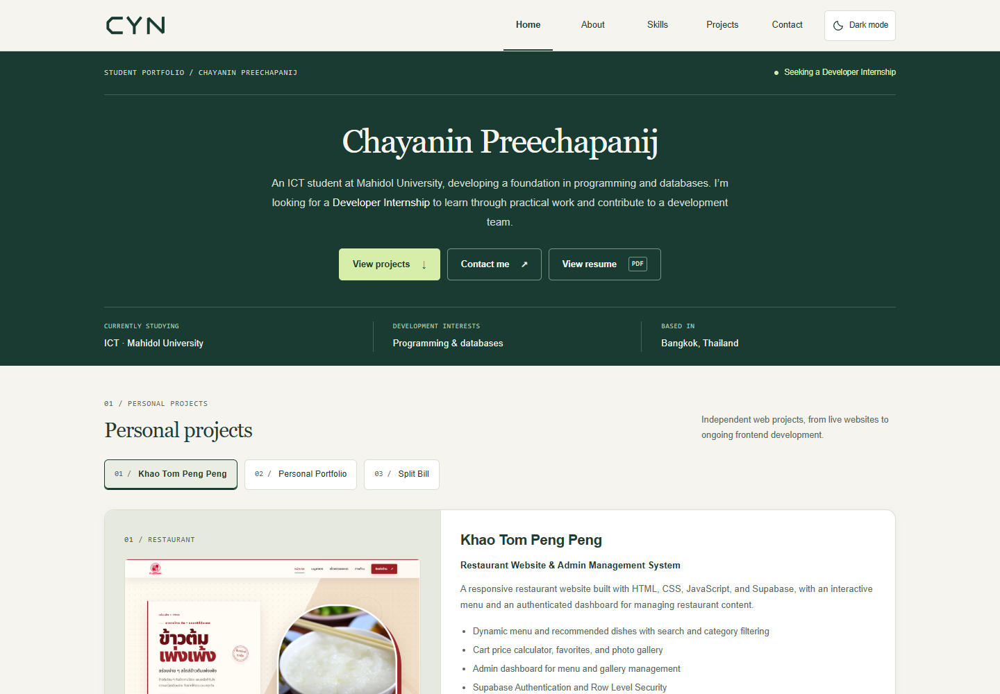

# CYN — Developer Portfolio

[English](README.md) | [ภาษาไทย](README.th.md)

An independently developed personal portfolio by **Chayanin Preechapanij**, a Digital Science and Technology student at Mahidol University, created for **Developer Internship applications**.

The website presents my profile, technical skills, personal and team projects, education, university activities, and contact information. A concise resume and a separate visual portfolio PDF provide complementary views of my development work.

## Website & application documents

| Resource | Purpose | Public link |
| --- | --- | --- |
| Live website | Interactive portfolio and contact page | [Visit portfolio](https://cynmark.github.io/resume/) |
| Resume PDF | One-page summary for internship applications | [Open resume](https://cynmark.github.io/resume/resume.pdf) |
| Portfolio PDF | Eight-page project showcase with screenshots and contributions | [Open portfolio](https://cynmark.github.io/resume/portfolio.pdf) |

Both documents also exist in this repository: [resume.pdf](resume.pdf) and [portfolio.pdf](portfolio.pdf). All three public resources were verified accessible on **15 November 2026**. The website links to the resume; the portfolio PDF is available through this README and its direct URL, with no dedicated website button yet.

## Website preview



Actual screenshot of the latest local homepage at a 1440 × 1000 desktop viewport. The same responsive website also supports tablet and mobile layouts.

## Key features

- **Responsive Design:** project images and content sit side by side on wider screens and stack on smaller screens. Navigation and actions wrap to fit available space.
- **Light Mode / Dark Mode:** the initial theme follows the system unless a preference is saved. The toggle stores the selection in `localStorage` and synchronizes changes across tabs. Switching still works when storage is unavailable.
- **Separate project showcases:** Personal Projects and Team Projects have distinct layouts, real screenshots, technology labels, and scope descriptions.
- **Scroll-based navigation:** all three personal project cards remain visible. Numbered links scroll to the corresponding card, account for the sticky header, and update the active indicator during manual scrolling. Team project links are anchors to their case studies.
- **Interactive Image Preview:** a shared native `<dialog>` provides fit/zoom controls. Close using the button, Escape, or the backdrop. Background scrolling is locked, keyboard focus stays inside the preview, and focus returns to the original trigger on close.
- **Project links:** GitHub and available Live Demo links are separate from image previews. External project links use `noopener noreferrer` when opening a new tab.
- **Application documents:** a one-page resume and an eight-page portfolio are available through the PDF links above.
- **Contact without a server:** the labeled form validates required fields and prepares a `mailto:` draft in the visitor’s configured email application. The visitor reviews and sends it there; the website does not submit or store messages. A direct email link is also provided.
- **CYN branding:** a scalable SVG wordmark links home from the header and footer, with a matching SVG favicon.
- **Accessibility considerations:** semantic sections, a skip link, descriptive image text, visible keyboard focus, native form validation, and modal focus management. Reduced-motion preferences disable smooth scrolling and decorative transitions.
- **Page navigation:** sticky header links track the current homepage section; both pages include a Back to top link.

## Portfolio sections

| Section | Content |
| --- | --- |
| Home / Introduction | Name, internship objective, development interests, and primary actions |
| Personal projects | Three independent projects with screenshots, features, technologies, and links |
| Built with a team | CondoFlow and Starbucks case studies, scope notes, and verified contributions |
| About me | Profile photo, academic foundation, and development interests |
| What I work with | Four skill groups: programming, frontend, database/backend services, and tools/deployment |
| Academic background | Mahidol University: B.Sc. in Digital Science and Technology, Faculty of ICT, GPA 2.57; Debsirin School: Math–Science, GPA 3.23 |
| Beyond the coursework | Languages and three Mahidol University activities from 2026 |
| Contact | Homepage invitation plus a dedicated page with email details and an email-draft form |

The activities are **Guest Relations — MUICT Open House**, **Activity Staff — Welcome Freshy**, and **Operations & Supply Support Staff — Raknong G8**.

## Featured projects

The stacks below describe the showcased projects, separately from the technologies powering this portfolio website.

### Personal Projects

#### 01 / Khao Tom Peng Peng

**Restaurant Website & Admin Management System · Live website**

A responsive restaurant website with a dynamic menu, recommended dishes, search and category filtering, a cart price calculator, favorites, and a photo gallery. The authenticated administration dashboard manages menu and gallery content using Supabase Authentication, Storage, and Row Level Security.

**Stack:** HTML5, CSS3, Vanilla JavaScript, Supabase, PostgreSQL, Supabase Authentication, Supabase Storage, Cloudflare Pages.

[GitHub](https://github.com/cynmark/khaotom-pengpeng) · [Live Demo](https://khaotom-pengpeng-public.pages.dev/)

#### 02 / Personal Portfolio Website

**Developer Internship Portfolio · Live website**

This independently developed, two-page website presents my background and practical work. Features include responsive layouts, persistent theme selection, section navigation, keyboard-accessible image previews with zoom, a resume link, and the email-draft contact form.

**Stack:** HTML5, CSS3, Vanilla JavaScript; deployed on GitHub Pages.

[GitHub](https://github.com/cynmark/resume) · [Live Demo](https://cynmark.github.io/resume/)

#### 03 / Split Bill — In Progress

**Expense Sharing Web Application · Frontend prototype**

An ongoing personal project exploring shared-expense workflows through responsive dashboards and English/Thai localization. Implemented interactions include group search, category filtering, in-memory group creation, activity search, Light/Dark themes, accessible dialogs, and expense forms with Equal, Exact, and Percentage split validation.

Group and expense changes reset on reload. Balances and insights use fixed sample data; there is no backend or real authentication. No public Live Demo is currently linked in the portfolio.

**Stack:** HTML5, CSS3, Vanilla JavaScript.

[GitHub](https://github.com/cynmark/split-bill)

### Team Projects

#### 01 / CondoFlow

**Unit and Tenant Management System · In development**

A Software Engineering Lab team prototype exploring admin, owner, tenant, and general-user workflows. Team features include unit and lease interfaces, batch invoicing, simulated payment review, maintenance requests, parcels, announcements, and charts with browser persistence.

**My contributions:** led team coordination, planned the core architecture and seven DFD workflows, and developed batch invoicing within the browser-based prototype.

**Team stack:** React, TypeScript, Vite, Tailwind CSS, Recharts, `localStorage`.

Authentication, permissions, and payment workflows are simulated. Data is stored in the browser rather than a production backend. A public Live Demo is not yet available in the portfolio.

[GitHub](https://github.com/AoojunHappyman/CondoFlow)

#### 02 / Starbucks Database Management System

**Relational Database Design · Academic team project / ITDS 221**

A database design study covering beverage ordering, inventory, and Starbucks Rewards. Team deliverables include business rules, original and improved Chen ER/EER diagrams, eight-step transform mapping, relational schemas in third normal form, and a data dictionary.

**Methods:** ER/EER modelling, relational design, transform mapping, 3NF, data dictionary.

This is documented database design, not a deployed application. The SQL files contain report comments rather than executable table definitions or sample inserts. The portfolio presents team deliverables without attributing unverified individual responsibilities.

[GitHub](https://github.com/cynmark/Starbucks-Database-Systems) · [Project report](https://github.com/cynmark/Starbucks-Database-Systems/blob/main/docs/project-report.pdf)

## Technology stack

Technologies used by **this portfolio website**:

| Area | Implementation |
| --- | --- |
| Structure | HTML5 with semantic sections, forms, `<details>`, and `<dialog>` |
| Styling | CSS3 custom properties, Grid, Flexbox, media queries, and theme overrides |
| Interactivity | Vanilla JavaScript, DOM events, `requestAnimationFrame`, `matchMedia`, and `localStorage` for theme preferences |
| Version control | Git and GitHub |
| Hosting | GitHub Pages |

The portfolio has no frontend framework, external UI library, package-based build system, application backend, or database. React, Supabase, and PostgreSQL appear in project descriptions; they do not power this site.

## Project Structure

```text
resume/
├── index.html
├── contact.html
├── styles.css
├── script.js
├── theme.js
├── assets/
│   ├── favicon.svg
│   ├── profile.jpg
│   ├── readme-homepage.png
│   ├── portfolio-preview.png
│   ├── khaotom-pengpeng-preview.png
│   ├── split-bill-preview.png
│   ├── condoflow-preview.png
│   └── starbucks-database-preview.png
├── resume.pdf
├── portfolio.pdf
├── README.md
├── README.th.md
├── .nojekyll
├── .gitattributes
└── .gitignore
```

- **`index.html`** contains the homepage, project cards, and shared preview dialog; **`contact.html`** contains contact details and the email-draft form.
- **`styles.css`** supplies shared design tokens, responsive layouts, theme colors, and interaction states for both pages.
- **`theme.js`** runs before the stylesheet to apply the saved or system theme before rendering. **`script.js`** is deferred and handles scroll indicators, image previews, and email drafts.
- **`assets/`** stores the original profile photo, SVG favicon, and real project/documentation screenshots. The CYN wordmark is inline SVG in both HTML files.
- **The PDFs** are separate application documents. **`.nojekyll`** bypasses Jekyll processing; **`.gitignore`** excludes local configuration and temporary files.

Page, asset, and document references use relative paths so they work under the GitHub Pages `/resume/` project path.

## Design system & user experience

The visual identity combines a geometric **CYN** wordmark with deep green (`#193b32`), warm ivory (`#f5f4ee`), and pale lime (`#d7edaa`). CSS variables provide dark-theme colors without duplicating page markup.

Georgia-based serif headings establish hierarchy, a Helvetica Neue/Arial sans-serif stack supports body readability, and monospace labels distinguish project numbers and technologies. These are system font stacks with no external font dependency.

Bounded content widths, rounded project cards, restrained borders, and consistent spacing support quick scanning. Images keep their aspect ratios, project actions stay distinct from preview controls, and anchor navigation preserves normal page scrolling. Hover feedback is paired with visible focus states; reduced-motion rules keep navigation usable without animation.

## Deployment

- **Host:** GitHub Pages
- **Repository:** [cynmark/resume](https://github.com/cynmark/resume)
- **Public site:** [cynmark.github.io/resume](https://cynmark.github.io/resume/)
- **Published content:** static HTML, CSS, JavaScript, image assets, and PDFs; no application build step is required.

Repository updates appear publicly after GitHub Pages completes a successful deployment from its configured publishing source. Local edits alone do not change the live website. The active publishing branch and source directory are managed in repository Pages settings and were not independently verified for this documentation update.

## Author & contact

**Chayanin Preechapanij** — Mahidol University student seeking a Developer Internship.

[Portfolio](https://cynmark.github.io/resume/) · [GitHub](https://github.com/cynmark) · [Email](mailto:chayanin.pre@mahidol.ac.th)
