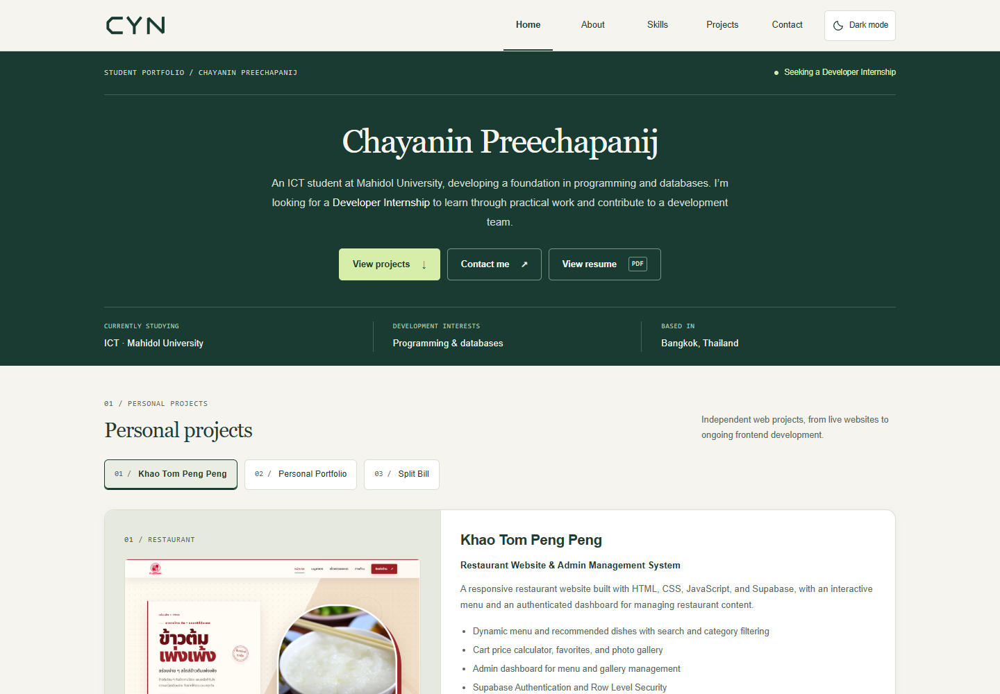

# CYN — Developer Portfolio

[English](README.md) | [ภาษาไทย](README.th.md)

เว็บไซต์ Portfolio ที่ **Chayanin Preechapanij** นักศึกษาสาขา Digital Science and Technology มหาวิทยาลัยมหิดล พัฒนาด้วยตนเองเพื่อใช้ประกอบการสมัคร **Developer Internship**

เว็บไซต์รวบรวมประวัติส่วนตัว ทักษะทางเทคนิค Personal Projects และ Team Projects การศึกษา กิจกรรมมหาวิทยาลัย และช่องทางติดต่อ พร้อม Resume แบบกระชับและ Portfolio PDF ที่นำเสนอภาพและรายละเอียดผลงานเพิ่มเติม

## เว็บไซต์และเอกสารสมัครงาน (Website & Documents)

| รายการ | เนื้อหา | ลิงก์สาธารณะ |
| --- | --- | --- |
| Live Website | Portfolio พร้อมฟังก์ชันโต้ตอบและหน้าติดต่อ | [เปิดเว็บไซต์](https://cynmark.github.io/resume/) |
| Resume PDF | สรุปข้อมูลสำหรับสมัครฝึกงาน 1 หน้า | [เปิด Resume](https://cynmark.github.io/resume/resume.pdf) |
| Portfolio PDF | นำเสนอผลงาน 8 หน้า พร้อมภาพและรายละเอียดส่วนร่วม | [เปิด Portfolio](https://cynmark.github.io/resume/portfolio.pdf) |

เอกสารทั้งสองอยู่ใน Repository: [resume.pdf](resume.pdf) และ [portfolio.pdf](portfolio.pdf) ตรวจสอบแล้วว่าลิงก์สาธารณะทั้งสามเปิดได้ ณ **15 พฤศจิกายน 2026** เว็บไซต์มีลิงก์เปิด Resume ส่วน Portfolio PDF เปิดได้ผ่าน README นี้และ URL โดยตรง โดยยังไม่มีปุ่มเฉพาะบนหน้าเว็บไซต์

## ภาพตัวอย่างเว็บไซต์ (Website Preview)



ภาพจริงจากหน้าแรกล่าสุดในโปรเจกต์ ขนาดหน้าจอ desktop 1440 × 1000 เว็บไซต์รองรับการปรับ layout สำหรับ tablet และ mobile ด้วย

## ฟีเจอร์หลัก (Key Features)

- **Responsive Design:** หน้าจอกว้างวางภาพและรายละเอียดโปรเจกต์คู่กัน ส่วนหน้าจอเล็กเรียงแนวตั้ง เมนูและลิงก์การทำงานขึ้นบรรทัดใหม่ได้ตามพื้นที่
- **Light Mode / Dark Mode:** เริ่มต้นตามธีมระบบเมื่อยังไม่มีค่าที่บันทึกไว้ ปุ่มสลับธีมเก็บค่าใน `localStorage` และซิงก์การเปลี่ยนแปลงระหว่างแท็บ หากใช้ storage ไม่ได้ยังสลับธีมได้ตามปกติ
- **Project Showcase แยกประเภท:** Personal Projects และ Team Projects ใช้ layout แยกกัน พร้อมภาพจริง เทคโนโลยี และคำอธิบายขอบเขตงาน
- **Project Navigation แบบเลื่อนหน้า:** การ์ด Personal Projects ทั้งสามแสดงพร้อมกันเสมอ ปุ่มหมายเลขเลื่อนไปยังการ์ดโดยเผื่อพื้นที่ sticky header และอัปเดตสถานะ active เมื่อเลื่อนหน้าเอง ส่วนลิงก์ Team Projects เป็น anchor ไปยังแต่ละ case study
- **Interactive Image Preview:** ภาพเปิดใน `<dialog>` ร่วมกัน มีปุ่มปรับภาพให้พอดีและซูม ปิดได้ด้วยปุ่ม Escape หรือคลิก backdrop ระหว่างเปิดจะล็อกการเลื่อนหน้าด้านหลังและจำกัด keyboard focus ภายใน preview เมื่อปิดจะคืน focus ให้ปุ่มต้นทาง
- **ลิงก์โปรเจกต์:** GitHub และ Live Demo ที่มีอยู่แยกจากปุ่มเปิดภาพ ลิงก์โปรเจกต์ภายนอกที่เปิดแท็บใหม่กำหนด `noopener noreferrer`
- **เอกสารสมัครงาน:** มี Resume 1 หน้าและ Portfolio 8 หน้าในรูปแบบ PDF ตามลิงก์ด้านบน
- **Contact ที่ไม่ใช้ server:** ฟอร์มมี label ตรวจสอบช่องที่จำเป็น และเตรียมร่างผ่าน `mailto:` ในแอปอีเมลที่ผู้ใช้ตั้งค่าไว้ ผู้ใช้ตรวจสอบและส่งจากแอปนั้นเอง เว็บไซต์ไม่ส่งหรือเก็บข้อความ และมีลิงก์อีเมลให้ติดต่อโดยตรง
- **แบรนด์ CYN:** ใช้ wordmark แบบ SVG ที่ขยายได้คมชัดใน header และ footer คลิกกลับหน้าแรกได้ พร้อม SVG favicon ที่สอดคล้องกัน
- **Accessibility:** มี semantic sections, skip link, คำอธิบายภาพ, keyboard focus ที่มองเห็นได้, native form validation และการจัดการ focus ใน modal รองรับ reduced motion โดยปิด smooth scrolling และ transition ตกแต่ง
- **การนำทางในหน้า:** sticky header แสดงสถานะ section ปัจจุบัน และทั้งสองหน้ามีลิงก์ Back to top

## ส่วนต่าง ๆ ของเว็บไซต์ (Portfolio Sections)

| ส่วน | เนื้อหา |
| --- | --- |
| Home / Introduction | ชื่อ เป้าหมายการฝึกงาน ความสนใจด้านการพัฒนา และปุ่มหลัก |
| Personal projects | โปรเจกต์ส่วนตัว 3 รายการ พร้อมภาพ ฟีเจอร์ เทคโนโลยี และลิงก์ |
| Built with a team | CondoFlow และ Starbucks พร้อมขอบเขตงานและส่วนร่วมที่ยืนยันแล้ว |
| About me | รูปโปรไฟล์ พื้นฐานการศึกษา และความสนใจด้านการพัฒนา |
| What I work with | ทักษะ 4 กลุ่ม: programming, frontend, database/backend services และ tools/deployment |
| Academic background | มหาวิทยาลัยมหิดล: B.Sc. in Digital Science and Technology คณะ ICT, GPA 2.57; โรงเรียนเทพศิรินทร์: Math–Science, GPA 3.23 |
| Beyond the coursework | ภาษาและกิจกรรมมหาวิทยาลัยมหิดล 3 รายการในปี 2026 |
| Contact | ส่วนเชิญชวนติดต่อในหน้าแรก และหน้าติดต่อแยกพร้อมอีเมลและฟอร์มเตรียมร่างข้อความ |

กิจกรรมประกอบด้วย **Guest Relations — MUICT Open House**, **Activity Staff — Welcome Freshy** และ **Operations & Supply Support Staff — Raknong G8**

## โปรเจกต์ที่นำเสนอ (Featured Projects)

เทคโนโลยีในส่วนนี้เป็นของแต่ละโปรเจกต์ แยกจากเทคโนโลยีที่ใช้สร้างเว็บไซต์ Portfolio นี้

### Personal Projects

#### 01 / Khao Tom Peng Peng

**Restaurant Website & Admin Management System · มีเว็บไซต์สาธารณะ**

เว็บไซต์ร้านอาหารแบบ Responsive มีเมนูแบบ dynamic เมนูแนะนำ การค้นหาและกรองหมวดหมู่ เครื่องคำนวณราคารวม รายการโปรด และแกลเลอรีภาพ มี administration dashboard สำหรับจัดการเมนูและแกลเลอรี โดยใช้ Supabase Authentication, Storage และ Row Level Security

**Stack:** HTML5, CSS3, Vanilla JavaScript, Supabase, PostgreSQL, Supabase Authentication, Supabase Storage, Cloudflare Pages

[GitHub](https://github.com/cynmark/khaotom-pengpeng) · [Live Demo](https://khaotom-pengpeng-public.pages.dev/)

#### 02 / Personal Portfolio Website

**Developer Internship Portfolio · มีเว็บไซต์สาธารณะ**

เว็บไซต์สองหน้าที่พัฒนาด้วยตนเองเพื่อนำเสนอประวัติและผลงาน รองรับ Responsive Design การบันทึกธีม การนำทางระหว่าง section การเปิดภาพและซูมด้วย keyboard ลิงก์ Resume และฟอร์มเตรียมร่างอีเมล

**Stack:** HTML5, CSS3, Vanilla JavaScript; เผยแพร่ผ่าน GitHub Pages

[GitHub](https://github.com/cynmark/resume) · [Live Demo](https://cynmark.github.io/resume/)

#### 03 / Split Bill — In Progress

**Expense Sharing Web Application · Frontend prototype**

โปรเจกต์ส่วนตัวที่อยู่ระหว่างพัฒนาเพื่อศึกษา workflow การแชร์ค่าใช้จ่าย ผ่าน dashboard แบบ Responsive และการแสดงผลภาษาอังกฤษ/ไทย ฟังก์ชันที่ทำแล้ว ได้แก่ ค้นหากลุ่ม กรองหมวดหมู่ สร้างกลุ่มในหน่วยความจำ ค้นหากิจกรรม สลับ Light/Dark Mode, accessible dialogs และฟอร์มค่าใช้จ่ายที่ตรวจสอบการแบ่งแบบ Equal, Exact และ Percentage

ข้อมูลกลุ่มและค่าใช้จ่ายที่เปลี่ยนแปลงจะรีเซ็ตเมื่อ reload ยอดคงเหลือและ insights ใช้ข้อมูลตัวอย่างคงที่ ยังไม่มี backend หรือ authentication จริง และยังไม่มีลิงก์ Live Demo สาธารณะใน Portfolio

**Stack:** HTML5, CSS3, Vanilla JavaScript

[GitHub](https://github.com/cynmark/split-bill)

### Team Projects

#### 01 / CondoFlow

**Unit and Tenant Management System · In development**

ต้นแบบที่พัฒนาเป็นทีมในวิชา Software Engineering Lab เพื่อศึกษาการใช้งานของ admin, owner, tenant และผู้ใช้ทั่วไป ผลงานรวมของทีมมีหน้าจัดการห้องและสัญญาเช่า batch invoicing การจำลองตรวจสอบการชำระเงิน งานซ่อม พัสดุ ประกาศ และกราฟ โดยเก็บข้อมูลใน browser

**ส่วนที่รับผิดชอบ:** นำการประสานงานทีม วางโครงสร้างหลักและ DFD workflows 7 ส่วน และพัฒนา batch invoicing ภายในต้นแบบที่ทำงานบน browser

**Team stack:** React, TypeScript, Vite, Tailwind CSS, Recharts, `localStorage`

Authentication สิทธิ์การใช้งาน และ workflow การชำระเงินเป็นการจำลอง ข้อมูลเก็บใน browser แทน production backend และยังไม่มี Live Demo สาธารณะใน Portfolio

[GitHub](https://github.com/AoojunHappyman/CondoFlow)

#### 02 / Starbucks Database Management System

**Relational Database Design · โปรเจกต์ทีมในรายวิชา ITDS 221**

งานออกแบบฐานข้อมูลสำหรับการสั่งเครื่องดื่ม สินค้าคงคลัง และ Starbucks Rewards ผลงานของทีมประกอบด้วย business rules, Chen ER/EER diagrams ก่อนและหลังปรับปรุง, transform mapping 8 ขั้นตอน, relational schemas ในรูปแบบ 3NF และ data dictionary

**วิธีการที่ใช้:** ER/EER modelling, relational design, transform mapping, 3NF, data dictionary

เป็นเอกสารออกแบบฐานข้อมูล ไม่ใช่แอปพลิเคชันที่ deploy แล้ว ไฟล์ SQL มี comments จากรายงาน ไม่ได้มีคำสั่งสร้างตารางหรือ sample inserts ที่รันได้ Portfolio นำเสนอผลงานทีมโดยไม่ระบุความรับผิดชอบส่วนบุคคลที่ยังไม่ได้ยืนยัน

[GitHub](https://github.com/cynmark/Starbucks-Database-Systems) · [Project report](https://github.com/cynmark/Starbucks-Database-Systems/blob/main/docs/project-report.pdf)

## เทคโนโลยีที่ใช้ (Technology Stack)

เทคโนโลยีที่ใช้สร้าง **เว็บไซต์ Portfolio นี้**:

| ส่วน | การใช้งาน |
| --- | --- |
| โครงสร้าง | HTML5 พร้อม semantic sections, forms, `<details>` และ `<dialog>` |
| รูปแบบการแสดงผล | CSS3 custom properties, Grid, Flexbox, media queries และ theme overrides |
| การโต้ตอบ | Vanilla JavaScript, DOM events, `requestAnimationFrame`, `matchMedia` และ `localStorage` สำหรับบันทึกธีม |
| Version control | Git และ GitHub |
| Hosting | GitHub Pages |

เว็บไซต์นี้ไม่มี frontend framework, external UI library, package-based build system, application backend หรือฐานข้อมูล React, Supabase และ PostgreSQL อยู่ในรายละเอียดโปรเจกต์ที่นำมาแสดง ไม่ได้ใช้ขับเคลื่อนเว็บไซต์นี้

## โครงสร้างโปรเจกต์ (Project Structure)

```text
resume/
├── index.html
├── contact.html
├── styles.css
├── script.js
├── theme.js
├── assets/
│   ├── favicon.svg
│   ├── profile.jpg
│   ├── readme-homepage.png
│   ├── portfolio-preview.png
│   ├── khaotom-pengpeng-preview.png
│   ├── split-bill-preview.png
│   ├── condoflow-preview.png
│   └── starbucks-database-preview.png
├── resume.pdf
├── portfolio.pdf
├── README.md
├── README.th.md
├── .nojekyll
├── .gitattributes
└── .gitignore
```

- **`index.html`** มีเนื้อหาหน้าแรก การ์ดโปรเจกต์ และ preview dialog ส่วน **`contact.html`** มีช่องทางติดต่อและฟอร์มเตรียมร่างอีเมล
- **`styles.css`** กำหนด design tokens, Responsive layout, สีธีม และสถานะการโต้ตอบที่ทั้งสองหน้าใช้ร่วมกัน
- **`theme.js`** ทำงานก่อน stylesheet เพื่อเลือกธีมที่บันทึกไว้หรือธีมระบบก่อนแสดงหน้า ส่วน **`script.js`** โหลดแบบ deferred เพื่อจัดการตัวบอก section การเปิดภาพ และร่างอีเมล
- **`assets/`** เก็บรูปโปรไฟล์ต้นฉบับ SVG favicon และภาพจริงของโปรเจกต์/เอกสาร ส่วน wordmark CYN เป็น inline SVG ใน HTML ทั้งสองหน้า
- **ไฟล์ PDF** เป็นเอกสารสมัครงานแยกกัน **`.nojekyll`** ให้ข้ามการประมวลผล Jekyll และ **`.gitignore`** ไม่รวมการตั้งค่าเฉพาะเครื่องและไฟล์ชั่วคราว

ลิงก์ระหว่างหน้า รูปภาพ และเอกสารใช้ relative paths เพื่อรองรับเว็บไซต์ GitHub Pages ที่อยู่ภายใต้ `/resume/`

## ระบบการออกแบบและประสบการณ์ใช้งาน (Design System & UX)

เว็บไซต์ใช้ wordmark **CYN** รูปทรงเรขาคณิต ร่วมกับสีเขียวเข้ม (`#193b32`) สีงาช้าง (`#f5f4ee`) และสี lime อ่อน (`#d7edaa`) โดยใช้ CSS variables กำหนดสีสำหรับ Dark Mode โดยไม่ต้องทำ markup แยก

หัวข้อใช้ serif ในกลุ่ม Georgia เพื่อแบ่งลำดับเนื้อหา ข้อความทั่วไปใช้ sans-serif ในกลุ่ม Helvetica Neue/Arial ส่วนหมายเลขและเทคโนโลยีใช้ monospace ทั้งหมดเป็น system font stacks จึงไม่ต้องโหลดฟอนต์จากภายนอก

การจำกัดความกว้างเนื้อหา การ์ดมุมโค้ง เส้นขอบที่ไม่เด่นเกินไป และระยะห่างสม่ำเสมอช่วยให้อ่านภาพรวมได้ง่าย ภาพรักษาสัดส่วนเดิม ลิงก์โปรเจกต์แยกจากปุ่ม preview และ anchor navigation ยังรองรับการเลื่อนหน้าแบบปกติ มีทั้ง hover feedback และ focus ที่ชัดเจน รวมถึง reduced-motion rules สำหรับผู้ที่ไม่ต้องการ animation

## การเผยแพร่เว็บไซต์ (Deployment)

- **Hosting:** GitHub Pages
- **Repository:** [cynmark/resume](https://github.com/cynmark/resume)
- **เว็บไซต์สาธารณะ:** [cynmark.github.io/resume](https://cynmark.github.io/resume/)
- **ไฟล์ที่เผยแพร่:** static HTML, CSS, JavaScript, ภาพ และ PDF โดยไม่ต้องมีขั้นตอน build แอปพลิเคชัน

การอัปเดต Repository จะแสดงบนเว็บไซต์เมื่อ GitHub Pages deploy สำเร็จจาก publishing source ที่ตั้งค่าไว้ การแก้ไฟล์ในเครื่องเพียงอย่างเดียวไม่เปลี่ยนเว็บไซต์สาธารณะ ส่วน branch และ source directory ที่ใช้เผยแพร่กำหนดใน Pages settings ของ Repository และยังไม่ได้ยืนยันโดยตรงในการปรับเอกสารครั้งนี้

## ผู้พัฒนาและช่องทางติดต่อ (Author & Contact)

**Chayanin Preechapanij** — นักศึกษามหาวิทยาลัยมหิดลที่กำลังมองหาโอกาส Developer Internship

[Portfolio](https://cynmark.github.io/resume/) · [GitHub](https://github.com/cynmark) · [Email](mailto:chayanin.pre@mahidol.ac.th)
